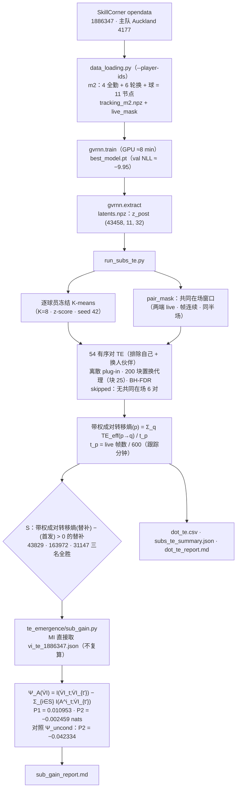

# 球员级传输熵 TE 协议

> 本文件是球员对球员 TE 计算的方法学协议（仓库 `gvrnn-te`）。
> 曾实现的**多变量 MTE**（条件化其余球员历史以剔除共同驱动）已终止；现统一为**两两 TE**。

---

## 1. 目标与定义

对每对球员（含球，共 K=11 个节点）计算**有向传输熵**：

$$TE(A \to B) = I\left(z^A_{t-1} ;\, z^B_t \mid z^B_{t-1}\right)$$

- $z^k_t$ ：球员 k 在 t 帧的 GVRNN 潜变量后验均值（32 维，10 Hz，§3）；
- **条件集 = 目标 B 自己的历史（一阶）**，不含第三方球员；
- 历史长度恒为 1（k=l=1）：潜链以 GRU 隐状态 $h_{t-1}$ 汇总历史而近似一阶 Markov；
- 输出：N×N 非对称 TE 矩阵 = 球队"信息流图"。

三种估计器（同一个 $I(X;Y \mid Z)$ ，只是 Z 取 $[z^B_{t-1}]$ ）：
**高斯闭式**（§6）、**KSG**（§5）、**离散 plug-in**（§7）。

## 2. 与 MTE 的关系（诚实声明）

MTE 条件化"其余所有球员的历史"以剔除第三方中转与共同驱动；TE 不做此条件化。后果是：
**共同驱动（同一帧共享输入同时进入多球员编码器）会在两两 TE 里造成伪显著边**——这是 TE 的
已知局限（`tests/test_te.py::test_te_common_driver_is_spurious` 明确记录）。因此本项目的 TE
一律解读为**"模型内的预测信息流"，不做因果断言**。`run_player_mte.py` 保留为弃用别名。

## 3. 数据流（6 步）

数据集在 `config.SKILLCORNER_DATA_DIR`（默认 `D:\SkillCorner_opendata\data`），无需复制进本项目。

**已核对的真实格式**（逐文件核实）：
- 每场比赛一个目录 `data/matches/<id>/`，文件带 `<id>_` 前缀：
  `<id>_tracking_extrapolated.jsonl`、`<id>_match.json`、`<id>_dynamic_events.csv`、
  `<id>_phases_of_play.csv`；
- tracking 帧字段：`frame`（10 fps）、`timestamp`、`period`（1/2，开头若干帧填充 null，
  长度因场次而异）、`ball_data{x,y,z,is_detected}`、`player_data[{x,y,player_id,is_detected}]`
  （**无速度**，须差分）；
- 坐标以球场中心为原点、米为单位，x=长边 ≈±52 m、y=短边 ≈±34 m；
- 门将 = `player_role.name == "Goalkeeper"`；tracking 的 `player_id` == `_match.json`
  `players[].id`（非 `trackable_object`）；
- 攻向来自 `phases_of_play.csv` 的 `attacking_side`。

```
1. 取数    SkillCorner Open Data（10 场 2024/25 澳超）
2. 建视    data_loading.export_gvrnn_npz：选一队 10 名外场球员 + 球（门将排除），
           按每节攻向镜像 x → tracking_teamX.npz
3. 训练    gvrnn.train：论文协议（50 帧窗口 50% 重叠、Adam 5e-4×0.999、教师强制、
           Xavier、验证 NLL 选模型）→ best_model.pt
4. 提取    gvrnn.extract：逐帧滤波，输出每球员后验均值 z_post (T, K, 32) → latents.npz
5. 降维    每球员 PCA → d 维；10 Hz 按 stride 降采样（默认 10 → 1 Hz）
6. TE      run_player_te：所有有序对 × 3 方法 × 参数网格 × 200 次块置换代理 → results/*.json
```

## 4. 预处理协议（全部变换"冻结"）

1. **降采样**：z_post 按 stride 取帧（10/stride Hz）；
2. **周期断裂**：pm[t] = (period[t] == period[t+1])，只保留同一半场内的转移；`--mask-gaps`
   时再把 stride 块内含死球间隙（diff(frame_times) > 0.11 s）的转移掩掉；
3. **PCA（冻结）**：每球员在**真实**降采样链上拟合，代理只 transform、不 refit；
4. **标准化（冻结）**：逐维 z-score（KSG 的 Chebyshev 半径跨维混合，必须先标准化）；
5. **离散化（冻结）**：K-means 只拟合一次，代理只重贴标签。

对齐约定（`run_player_te._triples`）：样本 s 对应转移 t→t+1，
X = A[:-1]、Y = B[1:]、Z = B[:-1]，n = T−1。

## 5. 方法 A：KSG（Frenzel–Pompe）

$$I(X;Y \mid Z) = \psi(k) + \Big\langle \psi(n_Z+1) - \psi(n_{XZ}+1) - \psi(n_{YZ}+1) \Big\rangle$$

全空间 (X,Y,Z) 上取第 k 近邻半径（Chebyshev，严格 "<"），在同一半径下于 Z、(X,Z)、(Y,Z)
三个边际空间分别数球。**两链时联合维数仅 3**（d=1），估计质量远好于 MTE 的 12 维。

## 6. 方法 B：条件高斯（偏协方差闭式）

$$I(X;Y \mid Z) = \tfrac{1}{2}\log_2 \frac{|S_{XZ}|\,|S_{YZ}|}{|S_Z|\,|S_{XYZ}|}$$

（`mte/gaussian.py`；S 为样本协方差 + 迹缩放岭 ridge=1e-3。）等价于 Geweke/Granger 因果
测度：X 在 Z 之外对 Y 的线性预测增量。**一维标准化的特例**：

$$TE = -\tfrac{1}{2}\log_2\left(1 - \rho^2_{XY \cdot Z}\right)$$

其中 $\rho_{XY \cdot Z}$ 为偏相关系数。只捕捉线性耦合，方差最低，是天然基线。
**Geweke χ² 交叉检验**：H0 下 $n \cdot 2 \cdot TE_{\text{nats}} \sim \chi^2(d_X \cdot d_Y)$ 。
直观几何见 `docs/te_gaussian_explained.md`。

## 7. 方法 C：离散条件 plug-in

$$TE_d = \sum p(y', y, x, z)\; \log_2 \frac{p(y' \mid y, x, z)}{p(y' \mid y, z)}$$

逐球员 K-means 量化后按样本均值估计 cell 对数比（`mte/discrete.py`）。**单元爆炸约束**：
联合直方图单元数 ≤ n / min_samples_per_cell（10），超限的对跳过并记入 `skipped`。
两链时 K=3 → 27 cells，远低于 n/10，故**两链 TE 下离散法总可用**。

## 8. 显著性协议（`mte/significance.py`）

1. **块置换代理**：只洗**源球员 A 的原始通道**（块长 25 帧@降采样率），B 与条件通道不动；
2. **冻结变换**：PCA/标准化/K-means 只 fit 一次（真实数据），代理只 transform；
3. S = 200：`TE_eff = raw − mean(代理)`，`p = (#{代理 ≥ raw}+1)/(S+1)`；
4. **多重比较**：（对 × 方法 × 参数）族做 BH-FDR（q=0.05）；
5. 高斯法另报 Geweke χ² p。

## 9. 参数网格（config.py）

| 参数 | 网格 | 说明 |
|---|---|---|
| pca_dims | 1, 2 | 每球员 PCA 维数 |
| stride | 5, 10 | 2 Hz / 1 Hz |
| k | 3, 5, 8 | KSG |
| n_clusters | 3, 5 | 离散法 |
| block_len | 25（稳健性重跑 {10, 50}） | 代理 |
| n_surrogates | 200 | |
| gaussian_ridge | 1e-3 | |

## 10. 输出格式（results/*.json）

```json
{
  "config": {"pca_dims": [1], "k": [3,5], "stride": 10, "..." : "..."},
  "input":  {"players": [0,1], "n_transitions": 4281, "latent_dim": 32},
  "results": {"0->1": {
      "gaussian": {"pca=1": {"raw": 0.0355, "eff": 0.030, "p": 0.005,
                             "chi2_p": 0.003, "surrogates": [200 个值]}},
      "ksg":      {"pca=1,k=3": {"raw": "...", "eff": "...", "p": "...", "surrogates": [...]}},
      "discrete": {"pca=1,K=3": {"raw": "...", "eff": "...", "p": "...", "surrogates": [...]}}
  }},
  "skipped": [{"pair": "0->1", "method": "discrete", "param": "pca=2,K=5",
               "reason": "cells 3125 > n/10"}],
  "matrices": {"gaussian": {"pca=1": {"raw": [[...]], "eff": [[...]], "p": [[...]]}}}
}
```

## 11. 合成验证（先于真实数据，`tests/`）

3 通道线性高斯系统（`mte/synthetic.py`，含**同帧驱动**项——GVRNN 共享输入混杂的诚实模型）：

| 场景 | 构造 | 验收标准 |
|---|---|---|
| null | 全部无耦合 | TE ≈ 0（高斯 <0.03、KSG <0.06）；代理不误拒 |
| direct | X→Y（b=0.5），C 独立 | TE > 0.10；高斯与 GT 差 <0.05 |
| **common_driver** | C 同帧驱动 X 与 Y | **两两 TE 伪显著 > 0**（TE 的已知局限，见 §2） |

`tests/test_te.py` 验证 TE 包装与共同驱动局限；`tests/test_mte_estimators.py` 验证底层
I(X;Y|Z) 估计器；`tests/test_frame_range.py` / `tests/test_bootstrap.py` 验证窗口与 bootstrap。

## 12. 已知偏差与诚实声明

1. **共同驱动伪显著**：两两 TE 无法剔除同一帧共享输入造成的耦合（§2）——只做"模型内信息流"
   解读；
2. **TE ≠ 因果**：Granger 式预测信息，不做因果断言；
3. **潜变量无语义**：z_t 各维无可读含义，TE 是信息流强度而非"传球/跑位"因果；
4. **一阶局限**：纯滞后 1 步的中转链 X→C→Y 是两步路径，一阶 TE 看不见（需二阶 TE，后续工作）；
5. **GVRNN 未公开超参**：潜维 32 / 隐层 128 为项目设定（config.py）。

## 13. 执行顺序

```bash
pytest tests/ -x                                     # 0. 合成验证必须全绿
python -m gvrnn.train --npz ... --out-dir ...        # 1. 单场单队 GVRNN
python -m gvrnn.extract --npz ... --model ... --out latents.npz   # 2. 潜链
python -m run_player_te --latents latents.npz --players 0,1 \    # 3. 两两 TE
    --pca-dims 1 --k 3 5 --n-clusters 3 --stride 10 \
    --n-surrogates 200 --block-len 25 --out te_0_1.json
# 4. 全矩阵 → 5. BH-FDR + 矩阵可视化
```

## 14. 潜状态 × 比赛阶段联合概率（`latent_phase.py`，研究分析）

为回答"GVRNN 潜状态 s 是否编码比赛阶段 φ"，用**离散计数**估计 P(φ,s)（与 TE 离散法同一
"冻结"哲学，但 φ 来自外部标注、s 来自潜变量）：

**计数规则（锁定）**：一次计数 = 一个 (帧 t, 球员 k) 对，须同时满足：
1. `live_mask[t,k]` 为真（离场帧的冻结潜变量不计数）；
2. `z_post[t,k]` 有限；
3. 帧 t 有阶段标签：`phases_of_play.csv` 的半开区间 [frame_start, frame_end)，边界帧归下一行
   （相邻行共享边界帧）；无任何行覆盖的帧（死球/停表/半场间隙）归显式 `dead` 类。

每个满足的对恰好计数 1 次：n[φ,s] += 1、N += 1。标签取"建模队视角"：我方持球 → in-possession
类型，否则 → out-of-possession 类型。符号化 s：逐球员逐维 z-score 后 K-means（n_init=10、
seed 冻结），按频率降序重命名（s0 = 最大簇）。互信息为 plug-in：
$I(\Phi; S) = \sum p(\varphi, s)\,\log_2\frac{p(\varphi, s)}{p(\varphi)\,p(s)}$ ，0 计数单元贡献 0。

三种口径同时输出（`results/latent_phase/`，`mi_summary.csv` 每行一个 scope）：
- `live_dead`：二元对照——潜状态编码"球是否在比赛中"的程度（已知：≈0.01–0.02 bits，很弱）；
- `full`：全帧（dead 为显式类）；`live_only`：仅覆盖帧——**活球内的阶段结构**（已知：
  K=8 时 ≈0.37–0.44 bits、norm ≈0.28–0.32，且所有球员共享同一原型-阶段结构，为共享 GNN 的
  队级性质）。

命令：

```bash
python -m latent_phase --latents <latents.npz> --live <tracking_pair1.npz> \
    --phases <id>_phases_of_play.csv --team-id 4177 \
    --players 0,1,2,3,4,5,6,7 --k 3,8 --seed 42 --out-dir results/latent_phase
```

同一对齐坐标下的**双向 TE**（`phase_te.py`，`results/phase_te/`）：
$TE(X \to Y) = I(y_{t+1};\, x_t \mid y_t)$ ，一次计数 = 一个转移 t→t+1（两端 live、帧连续、
同半场；live_only 再要求两端都被相位行覆盖）。`z->phi` 与 `phi->z` 均用离散 plug-in、
源链块置换（块 25）代理。已知结果（1886347, K=8, 200 代理）：**phi→z 全 8 球员双口径
p=0.005（eff ≈ 0.003–0.006 bits），z→phi 全口径 8/8 显著（live_only 4/8）**——阶段链
预测潜链演化强于反向；K=3 无信号。φ 为场级链（8 球员测试不独立）、TE≠因果，见 §12。

## 15. 带权成对转移熵（`dotTE`）：替补 / 被替补球员对队友的 TE（`run_subs_te.py`，GVRNN 计算协议）

> 术语：**带权成对转移熵**（weighted pairwise transfer entropy）即「成对 TE 之和 ÷ 在场时间」，
> 记为 $\dot{TE}$ ；代码与结果文件沿用标识 `dotTE`（如 `dot_te.csv`、`--dot-te`、`dot_te_report.md`）。
> 宏观涌现变量为**信息变差率** $\dot{VI}$ （逐样本 Variation of Information，Pereira et al. 2021），
> vi-te 数据文件中记作 `VI`（i_macro / per_player_mi 字段）。

**协议口径**（依据 GVRNN计算协议.txt）：
- 带权成对转移熵 $\dot{TE}(p) = \frac{1}{t_p}\sum_q TE_{\mathrm{eff}}(p \to q)$ ，其中 $t_p$ 为 p 的在场**跟踪**分钟（live 帧数 / 600）。
- 目标集 = 模型内其余外场节点，**排除自己与换人伙伴**；无共同在场时段的对（n=0）
  标记 `skipped`、不进求和。
- $S = \lbrace \text{sub}\ p : \dot{TE}(p) > \dot{TE}(\text{starter}(p)) \rbrace$ ，`sub` 为替补、`starter` 为被其替换的首发。
- $\Psi_A(\dot{VI}) := I(\dot{VI}_t;\, \dot{VI}_{t'}) - \sum_{i \in S} I(A^i_t;\, \dot{VI}_{t'})$ （`te_emergence/sub_gain.py`）：
  $I(\dot{VI}_t; \dot{VI}_{t'})$ 与每球员 $I(A^i_t; \dot{VI}_{t'})$ 直接取自 vi-te 的 vi_te_<match>.json
  （1 Hz、nats、半场全局口径），本模块只做减法、不复算。

**模型设计（m2）**：GVRNN 固定 K=11 节点（10 外场 + 球），单模型单潜空间保证 $\dot{TE}$
跨球员可比 → 节点 = **4 全勤（按位置覆盖：RB/LB/RCB/AM）+ 6 轮换（3 替补 + 3 被替补）
+ 球**。TE 只在共同在场窗口上估计（源窗口自动由 live_mask 限定，即协议 t1 / 100−t1
窗口）。全勤 7 人中只取 4 人是 K=11 的容量取舍（目标集 = 4 全勤 + 5 其他轮换）。

**估计器**：与 §14 phase_te 同管线——逐球员冻结 K-means（K=8、z-score、seed 42），
10 Hz 转移（两端 live、帧连续、同半场），离散 plug-in TE，200 次块置换代理（块 25），
eff = raw − 代理均值，p 地板 1/201，BH-FDR（q=0.05）跨对族。输出
`results/subs_te/`：dot_te.csv（每对一行 + skipped 标注）、subs_te_summary.json
（每源 $\dot{TE}$ / 差值 / S）、dot_te_report.md、sub_gain_report.md；4 张管线结果图
（sub1–sub4）由 `te_emergence/sub_figures.py` 生成于 `results/subs_te/figures/`。

**已知限制**：目标数物理上不等（共同在场约束，6–8 个/源）→ 报均值口径作敏感性；
t_p 为跟踪口径分钟（比赛时钟略长，含丢帧死球段）；短窗（Smith ≈ 7 跟踪分钟）
代理偏差按列报告；TE≠因果，见 §12。

**管线流程图**（Mermaid；GitHub / VS Code + Mermaid 插件可直接渲染）：


