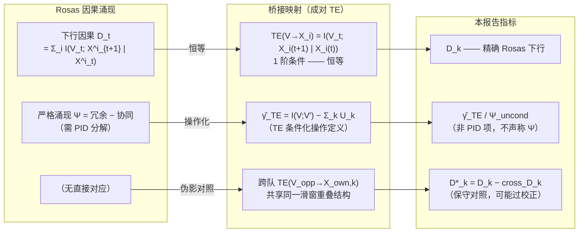
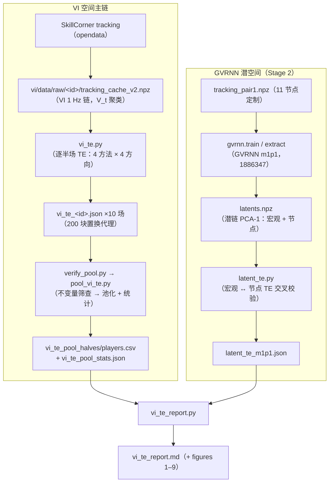
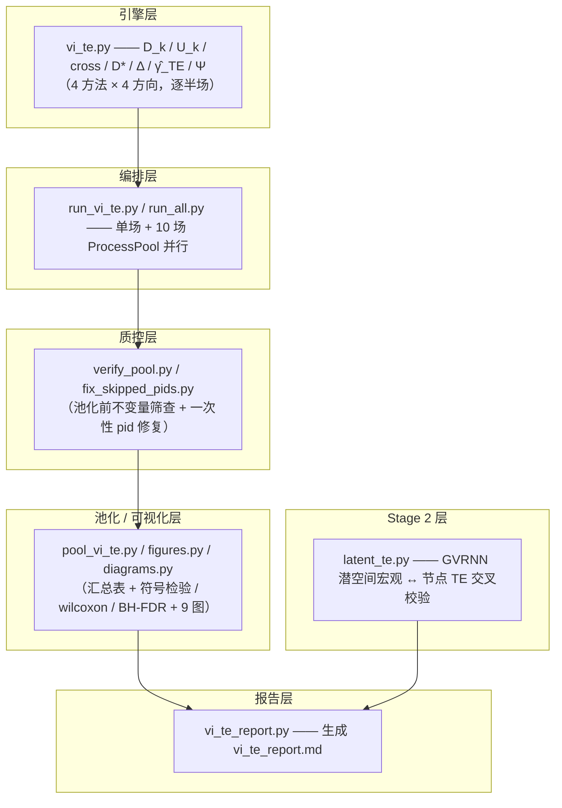
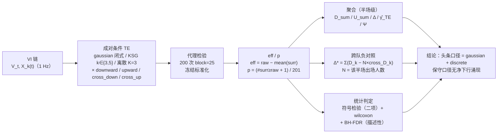
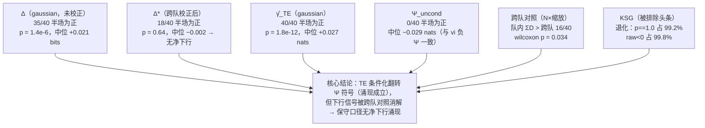

# TE ↔ VI 因果涌现桥接 —— Mermaid 流程图（文本版）

对应 PNG 版：`D:\MarkovSoccerTE\vi_bridge\results\figures\fig5..fig9.png`。
在支持 Mermaid 的 Markdown 阅读器（VS Code + Mermaid 插件 / GitHub / Typora）中可直接渲染。

## 图 5 · 桥接概念（Rosas 因果涌现 ↔ 转移熵 TE）

## 图 6 · 数据流向（两条链汇合到成果报告）

## 图 7 · 模块组件（vi_bridge 包分层）

## 图 8 · 技术路径（单半场 TE 估计流水线）

## 图 9 · 成果汇总（10 场 × 40 半场头条数字）

