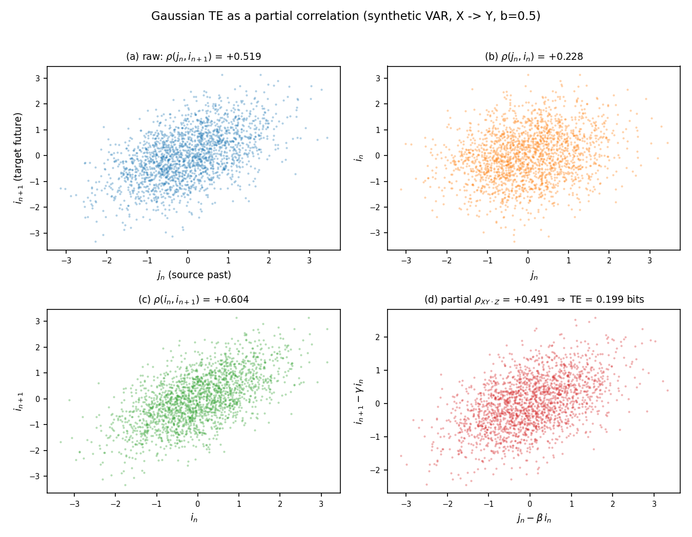
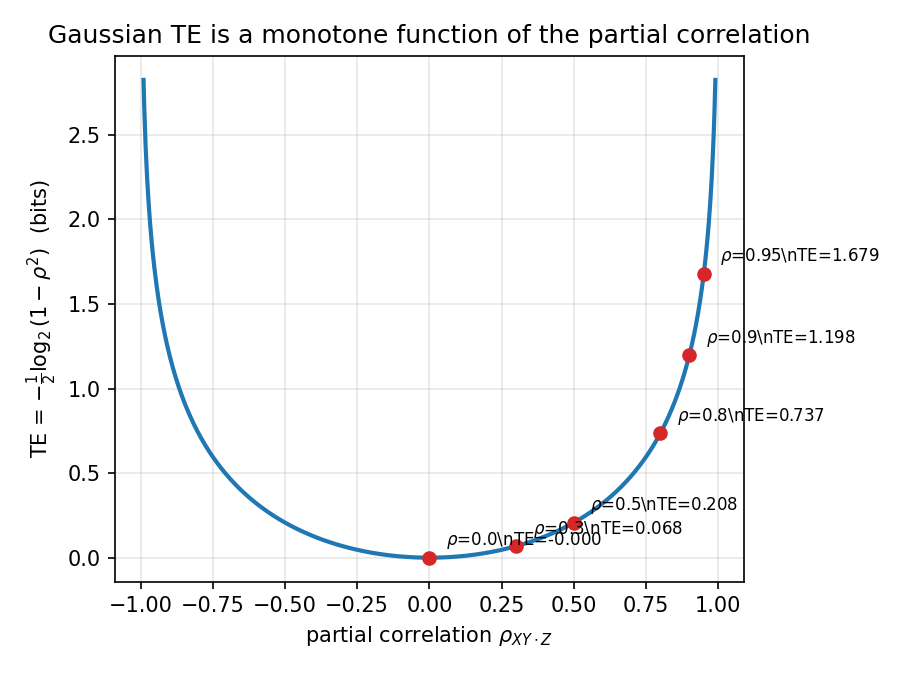
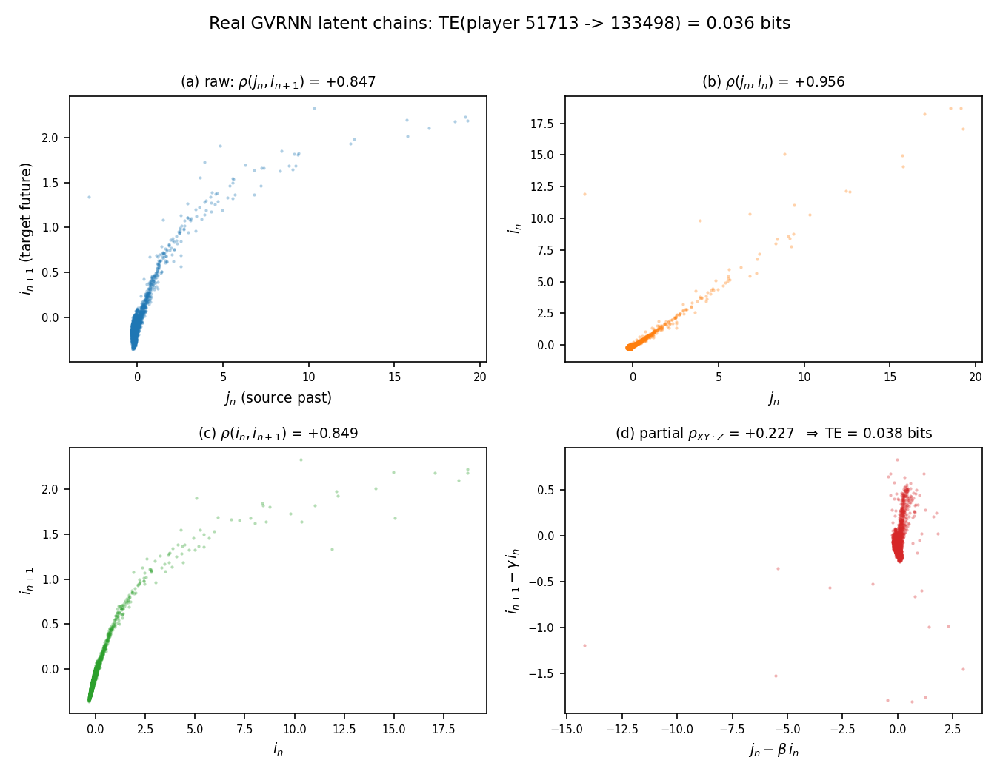
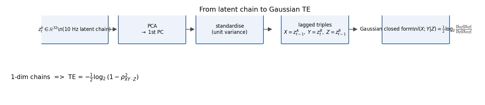

# 高斯法 TE 的直观解释（附可视化）

> 本文是 `docs/figures/` 中四张图的配套说明，供写文章/报告时直接引用。
> 图由 `scripts/plot_te_gaussian.py` 生成，可复现。

## 1. 我们算的是什么

两条球员潜链 $I$（源）与 $J$（目标，下文记作 $B$ 以便与代码一致）之间的一阶传输熵
（Schreiber 2000，嵌入 $k=l=1$）：

$$
T_{J\to I} \;=\; \sum_{i_{n+1},\,i_n,\,j_n} p(i_{n+1},i_n,j_n)
\log_2 \frac{p(i_{n+1}\mid i_n,j_n)}{p(i_{n+1}\mid i_n)}
\;=\; I\big(j_n\,;\,i_{n+1}\mid i_n\big)
$$

即：**在已知目标自身历史 $i_n$ 之后，源历史 $j_n$ 还能为目标的未来 $i_{n+1}$ 提供多少额外
信息（bits）。** 代码里的三元组对应关系是

$$
X = j_n = z^J_{t-1},\qquad Y = i_{n+1} = z^I_t,\qquad Z = i_n = z^I_{t-1}.
$$

## 2. 高斯法：把"概率求和"换成"协方差闭式解"

Schreiber 原始公式是对离散符号的概率求和；我们的潜链是**连续**的 32 维向量，直接数概率会
爆炸（且潜链本身是连续状态，没有有限状态集）。高斯法假设三元组 $(X,Y,Z)$ 服从**联合高斯**，
此时条件互信息有闭式解（`mte/gaussian.py`）：

$$
I(X;Y\mid Z) \;=\; \frac{1}{2}\log_2
\frac{|S_{XZ}|\;|S_{YZ}|}{|S_Z|\;|S_{XYZ}|}
$$

其中 $S_{(\cdot)}$ 是样本协方差矩阵（ddof=1，并加迹缩放岭正则 $\lambda=10^{-3}$ 防近奇异）。
这就是**多源 Granger 因果的 Geweke 测度**（Barnett et al. 2009）：联合高斯下，传输熵 ≡ 线性
预测增量。

## 3. 一维情形的漂亮化简：TE 就是偏相关系数的一个函数

每条链先做 PCA 取第一主成分、再标准化（零均值单位方差）后，$X,Y,Z$ 各是 1 维，上面的行列式比
完全展开，退化成只依赖**三个皮尔逊相关系数**：

$$
T_{J\to I} \;=\; -\frac{1}{2}\log_2\!\Big(1-\rho^2_{XY\cdot Z}\Big),
\qquad
\rho_{XY\cdot Z} = \frac{\rho_{XY}-\rho_{XZ}\,\rho_{YZ}}
{\sqrt{(1-\rho_{XZ}^2)(1-\rho_{YZ}^2)}}
$$

三个原始相关系数分别是 $\rho_{XY}=\rho(j_n,i_{n+1})$、$\rho_{XZ}=\rho(j_n,i_n)$、
$\rho_{YZ}=\rho(i_{n+1},i_n)$。**偏相关系数 $\rho_{XY\cdot Z}$ 就是"把 $i_n$ 从 $j_n$ 和
$i_{n+1}$ 里都线性剔除之后，两者残余的相关"** —— 这正是 TE 想度量的事：剔除了目标自身持续性
之后的净信息流。

- 若 $\rho_{XY}$ 高，但完全由 $i_n$（目标的持续性 $\rho_{YZ}$）和 $j_n$ 与 $i_n$ 的共变
  （$\rho_{XZ}$）解释，则 $\rho_{XY\cdot Z}=0$，TE = 0 —— 没有净信息流。
- 偏相关越强，TE 越大；TE 是偏相关的**单调非线性**函数。

## 4. 几何直观（图 1）

合成 VAR 系统 $X\to Y$（$b=0.5$）的四个散点图：

- **(a)** $j_n$ 对 $i_{n+1}$：raw 相关 $\rho_{XY}=0.519$，看起来信息流很强；
- **(b)(c)** 但 $i_{n+1}$ 与 $i_n$ 的相关 $\rho_{YZ}=0.604$（目标自身持续性很强），
  $j_n$ 与 $i_n$ 也有 $\rho_{XZ}=0.228$；
- **(d)** 把 $i_n$ 线性剔除后，残余相关 = 偏相关 $\rho_{XY\cdot Z}=0.491$，
  $\Rightarrow$ TE = $-\frac12\log_2(1-0.491^2)=0.199$ bits。

即：0.519 的 raw 相关里，一部分是目标自身的持续性"借"来的；净信息流对应 0.491 的偏相关。

## 5. TE 与偏相关的映射（图 2）

$T=-\frac12\log_2(1-\rho^2)$ 在 $[0,1)$ 单调递增：$\rho=0\to T=0$；$\rho=0.5\to 0.208$ bits；
$\rho=0.8\to 0.737$ bits；$\rho=0.9\to 1.198$ bits。偏相关接近 1 时 TE 发散（完全线性确定）。

## 6. 真实球员对（图 3）

对真实 GVRNN 潜链（交付方本地的 1886347 试点场 `latents.npz`，**不在本包内**——本包只含代码，
运行产物由 Z 按 00_HANDOFF.md 重新生成）做同样的几何分解：球员 51713（Elliot，右后卫）
$\to$ 133498（De Vries，左后卫），全场 1 Hz 降采样后 $n=4281$ 个转移，TE = **0.0355 bits**。
量级与整套分析中"高斯 TE ≈ 0.01–0.05 bits"一致；同样可以看到 raw 相关被目标自身持续性削掉
一部分后剩下的净偏相关。

## 7. 完整流水线（图 4）

$$
\underbrace{z^k_t\in\mathbb{R}^{32}}_{\text{10 Hz 潜链}}
\;\xrightarrow{\;\text{PCA}\;}
\underbrace{1\text{-dim}}_{\text{第一主成分}}
\;\xrightarrow{\;\text{标准化}\;}
\underbrace{\text{单位方差}}_{\text{相关系数}}
\;\xrightarrow{\;\text{滞后三元组}\;}
\underbrace{(X,Y,Z)}_{\text{上表}}
\;\xrightarrow{\;\text{高斯闭式}\;}
\underbrace{\text{TE}}_{\text{bits}}
$$

## 8. 关键性质（写进文章）

1. **单位**：bits（$\log_2$）；`raw` 是估计器原始输出，`eff = raw − mean(代理)` 是代理校正值。
2. **线性性**：高斯法只度量**线性（高斯等价）**信息流。若耦合是非线性的，需要用 KSG
   （非参数 k 近邻）交叉验证；两链时联合空间仅 3 维，KSG 可用。
3. **方向性**：$T_{J\to I}\neq T_{I\to J}$，矩阵非对称。
4. **显著性与 p 值**：块置换代理（只洗源链，冻结 PCA/标准化）给出 `p`；高斯法另给 Geweke
   $\chi^2$ 检验 $n\cdot 2\cdot \text{TE}_{\text{nats}}\sim\chi^2(d_X d_Y)$。
5. **≠ 因果**：TE 是 Granger 式的预测信息，只做"模型内信息流"解读，不做因果断言。
