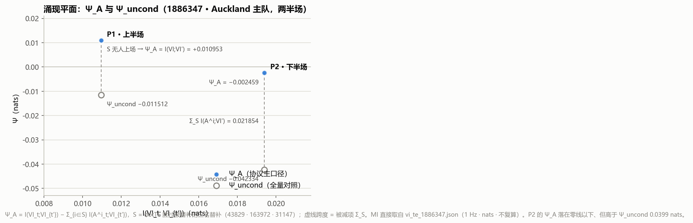
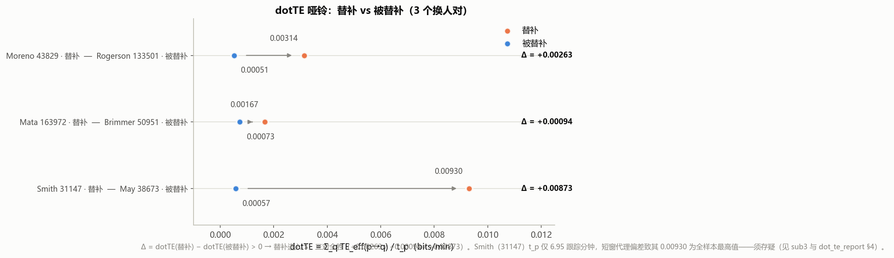
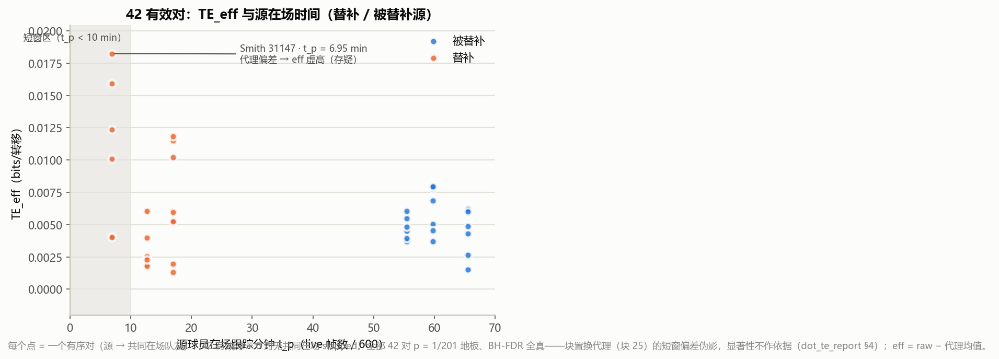
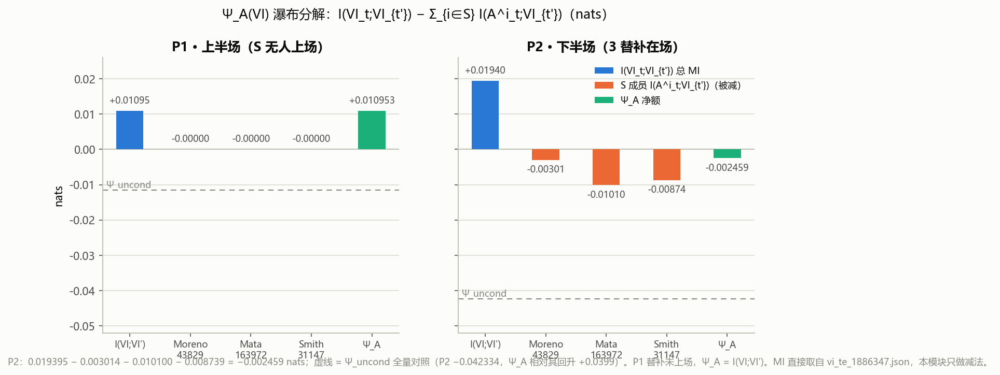

# dotTE → Ψ_A(VI) 管线结果报告

> **一句话结论**：三名替补的 dotTE **全部胜过**被替补者（S = {43829, 163972, 31147}）；
> 扣除替补信息增益后，下半场宏观涌现 **Ψ_A(VI) = −0.002459 nats**——即 P2 的 VI 宏观动态
> 几乎完全由三名替补的个体贡献解释（相对全量口径 Ψ_uncond = −0.042334 回升 +0.0399 nats）。

- 比赛 **1886347** · 主队 **Auckland（team 4177）** · 模型 **m2**（11 节点单潜空间）
- 数据来源：SkillCorner opendata（MIT © SkillCorner），须注明来源并在发布时通知 SkillCorner
- 协议：`PROTOCOL.md §15`；复现命令见 [dot_te_report.md](dot_te_report.md) 与 [sub_gain_report.md](sub_gain_report.md)

---

## 一、关键数值

| 指标 | P1 上半场 | P2 下半场 |
|---|---|---|
| i_macro = I(VI_t; VI_{t'}) | +0.010953 | +0.019395 |
| Σ_{i∈S} I(A^i_t; VI_{t'})（被减项） | 0（替补未上场） | 0.021854 |
| **Ψ_A(VI) = i_macro − Σ_S** | **+0.010953** | **−0.002459** |
| Ψ_uncond（全量对照） | −0.011512 | −0.042334 |

单位 nats/步（×1.4427 → bits）。MI 直接取自 `vi_te_1886347.json`，本管线只做减法、不复算。

| 换人对 | dotTE(替补) | dotTE(被替补) | 差值 | 判定 |
|---|---|---|---|---|
| 43829 Moreno ↔ 133501 Rogerson | 0.003145 | 0.000514 | +0.002631 | 替补胜 → 入 S |
| 163972 Mata ↔ 50951 Brimmer | 0.001669 | 0.000734 | +0.000935 | 替补胜 → 入 S |
| 31147 Smith ↔ 38673 May | 0.009305 | 0.000575 | +0.008730 | 替补胜 → 入 S |

**S = [43829, 163972, 31147]**（三名替补全胜）。dotTE 单位 bits/min。

---

## 二、四张管线结果图

（由 `te_emergence/sub_figures.py` 生成，`figures/` 子目录，随仓库发布）

### 图 1 · 涌现平面：Ψ_A 与 Ψ_uncond

每个点 = 一个半场，蓝 = 协议主口径 Ψ_A，灰空心 = 全量对照 Ψ_uncond，虚线跨度 = 被减项
Σ_S I(A^i;VI′)。P1 替补未上场，Ψ_A = I(VI;VI′) 落在零线上方；P2 扣掉三名替补贡献后
Ψ_A 跌到 −0.002459，但仍显著高于全量口径的 −0.042334。

### 图 2 · dotTE 哑铃：替补 vs 被替补

三个换人对，橙 = 替补、蓝 = 被替补，箭头指向更大者。三对 Δ 全为正——替补在单位在场分钟内
向队友传递的信息量均高于被其替换的首发，这是 S 判定的直接依据。

### 图 3 · 成对散点：TE_eff 与源在场时间

每个点 = 一个有序对（源 → 共同在场队友），共 42 有效对 + 6 对无共同在场 skipped。
左端灰底为短窗区（t_p < 10 min）。**Smith（31147）仅 6.95 跟踪分钟**，其 eff 高值
（含全样本最高 0.0182）是块置换代理的短窗偏差伪影，须存疑。

### 图 4 · Ψ_A 瀑布：减法分解

P1 / P2 两面板共享 y 轴：蓝 = i_macro 总 MI，橙 = 三名替补的个体贡献（被减），
青 = Ψ_A 净额，虚线 = Ψ_uncond 对照。P2：
**0.019395 − 0.003014 − 0.010100 − 0.008739 = −0.002459 nats**。

---

## 三、诚实声明与限制

1. **显著性不可用**：42/42 对 p 值全部落在 1/201 地板、BH-FDR 全真——块置换代理（块 25）
   在短窗下的偏差伪影，因此图 3 的 eff 只能做量级解读，不做显著性断言。
2. **短窗**：Smith 的 t_p 仅 6.95 跟踪分钟，其 dotTE 0.009305 为全样本最高值，最不可靠。
3. **TE ≠ 因果**：成对 TE 是模型内预测信息流（Granger 式），共同驱动会造成伪显著边
   （见 `PROTOCOL.md §2/§12`）。
4. **单场单队**：全部结论来自 1886347 主队一个样本（两半场），外推须谨慎。

---

## 四、详细报告

- 每对 TE 明细、dotTE 汇总与 S 判定 → [dot_te_report.md](dot_te_report.md)
- Ψ_A(VI) 计算与被减项明细 → [sub_gain_report.md](sub_gain_report.md)
- 原始数据 → [dot_te.csv](dot_te.csv) · [subs_te_summary.json](subs_te_summary.json)
