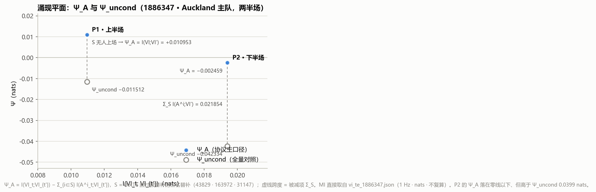
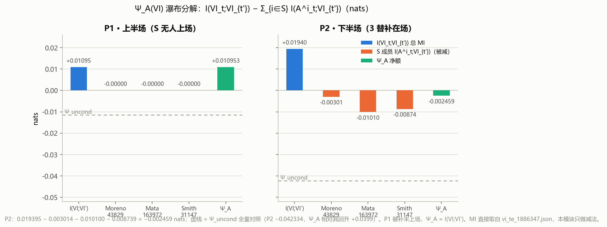

# Ψ_A(V̇I)：替补信息增益与比赛宏观动态的因果涌现（GVRNN 计算协议）
- VI 数据：`results\vi_te_1886347.json`（home|1 / home|2，1 Hz，MI 单位 nats）
- dotTE 数据：`results\subs_te\subs_te_summary.json`

## 1. 协议公式

$$S = \left\lbrace\ \text{sub}\ p : \dot{TE}(p) > \dot{TE}(\text{starter}(p))\ \right\rbrace$$

$$\Psi_A(\dot{VI}) := I(\dot{VI}_t; \dot{VI}_{t'}) - \sum_{i \in S} I(A^i_t; \dot{VI}_{t'})$$

> 术语：宏观变量为**信息变差率** $\dot{VI}$ （逐样本 Variation of Information，Pereira et al. 2021）；vi-te 数据文件中记作 `VI`（i_macro / per_player_mi 字段），下文符号注解中的 `I(VI_t; VI_{t'})` 即 $I(\dot{VI}_t; \dot{VI}_{t'})$ 。

- `dotTE(p)`（带权成对转移熵 $\dot{TE}$ ）：p 对全部共同在场队友的 TE_eff 之和 ÷ 在场跟踪分钟（见 dot_te_report.md）。
- `S`：TE 上胜过所替换首发的**替补**集合。
- `I(VI_t; VI_{t'})`：i_macro_nats——全队信息变差率链的一步自预测信息。
- `I(A^i_t; VI_{t'})`：per_player_mi_nats——球员 i 对信息变差率下一步的互信息（vi-te 半场全局口径，不复算）。
- 替补只在下半场出场 → 上半场 S 交集为空，Ψ_A(P1) = i_macro 原值。

## 2. S 判定（dotTE 差值）

| 替补 | 首发 | dotTE(替补) | dotTE(首发) | 差值 |
|---|---|---|---|---|
| 43829 | 133501 | 0.003145 | 0.000514 | +0.002631 |
| 163972 | 50951 | 0.001669 | 0.000734 | +0.000935 |
| 31147 | 38673 | 0.009305 | 0.000575 | +0.008730 |

**S = [43829, 163972, 31147]**

## 3. Ψ_A(V̇I) 计算

| 半场 | i_macro | S 中在场者 | 减项合计 | **Ψ_A(V̇I)** | 全量 Ψ_uncond（对照） | Δ(Ψ_A − Ψ) |
|---|---|---|---|---|---|---|
| P1 | 0.01095 | ∅ | 0.00000 | **0.01095** | -0.01151 | +0.02247 |
| P2 | 0.01940 | [43829, 163972, 31147] | 0.02185 | **-0.00246** | -0.04233 | +0.03987 |

- 全量 Ψ_uncond = i_macro − Σ_{全体 10 人} I(A^i; VI′)（vi 项目口径）。
- Δ = Ψ_A − Ψ_uncond = 被“放行”的非 S 球员贡献之和（恒正）：只减 S 后，涌现值比全量口径高出的部分，即轮换体系内其余球员（含被替换首发与全勤球员）贡献的规模。

## 4. 被减项明细

| 半场 | 替补 pid | I(A^i; VI′) [nats] |
|---|---|---|
| P2 | 43829 | 0.00301 |
| P2 | 163972 | 0.01010 |
| P2 | 31147 | 0.00874 |

## 5. 符号注解

- `i_macro`（= I(VI_t; VI_{t'})）：全队 VI 自预测互信息，nats/步。
- `per_player_mi`（= I(A^i_t; VI_{t'})）：球员 i 与 VI 下一步的无条件互信息，nats/步，按半场全局计算。
- `Ψ_uncond`：全量口径涌现 = i_macro − Σ_{10 人} MI（vi 项目 Task 2）。
- `Ψ_A(V̇I)`：协议口径 = i_macro − Σ_{i∈S} MI。
- 单位：nats（×1.4427 → bits）。

## 6. 结果可视化

（由 `te_emergence/sub_figures.py` 生成，`results/subs_te/figures/`，与 `te_emergence/figures` 同一设计系统）

- **图 1 · 涌现平面**：Ψ_A（主口径，蓝）与 Ψ_uncond（全量对照，灰）对 I(V̇I_t; V̇I_{t'})，P1/P2 两半场，虚线跨度 = Σ_S I(A^i; V̇I′)

  

- **图 4 · Ψ_A 瀑布**：I(V̇I_t; V̇I_{t'}) − Σ_{i∈S} I(A^i_t; V̇I_{t'}) 的减法分解（P1/P2 两面板，nats），虚线 = Ψ_uncond 对照

  

（四张图的汇总版见 [pipeline_report.md](pipeline_report.md)）
